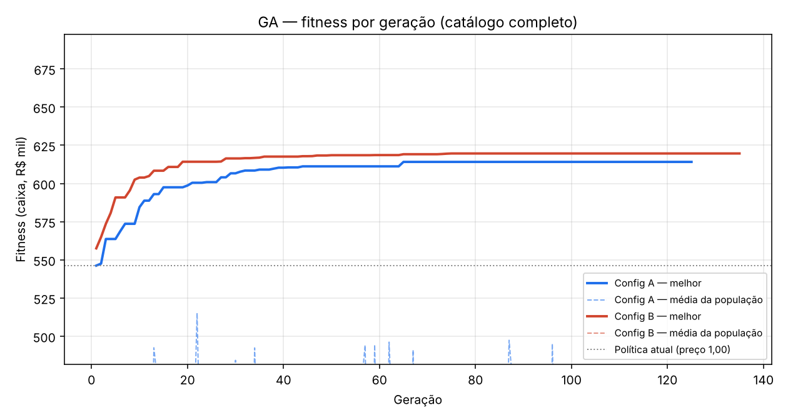
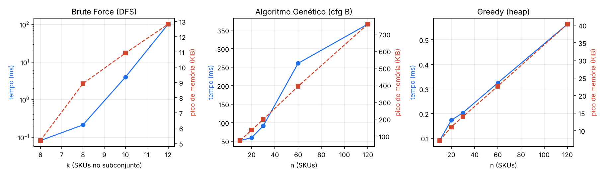

# Questão 1 — Operação Caixa 90

Grupo **G01** · instância `386e6252eb25` · seed dos algoritmos **1025** · 30 SKUs

*Gerado automaticamente em 26/10/2026 22:38. Não editar à mão: rode o main.py de novo.*

**Nesta questão utilizamos 3 algoritmos.** O *Brute Force* calcula o ótimo exato num subconjunto pequeno; o *Algoritmo Genético* roda no mesmo subconjunto (o gap mede sua qualidade) e depois no catálogo completo; a política de preços do GA é a entrada do *Greedy*, que distribui o orçamento de incentivo comercial.

Restrições: margem mínima 7,79% (R1); desconto abaixo de 0,90 só para estoque com 120+ dias (R2); no máximo 12 SKUs com desconto (R3); giro do estoque a custo ≥ 84,16%, o giro da política atual (R4). SKUs sem preço viável (suspensos): Q1-028.

## 1. Brute Force × Algoritmo Genético (subconjunto)

Subconjunto: os 10 SKUs de maior valor de estoque a custo (Q1-002, Q1-003, Q1-004, Q1-005, Q1-011, Q1-014, Q1-019, Q1-024, Q1-027, Q1-030). Espaço de busca: 100.800 combinações; a DFS visitou 18.882 nós (podas de R3/R4). A coluna *política* lista o nível de preço de cada SKU, na ordem acima.

| metodo              |      caixa |   gap_pct |   tempo_ms |   memoria_pico_KiB |   avaliacoes | viavel   | politica                                          |
|:--------------------|-----------:|----------:|-----------:|-------------------:|-------------:|:---------|:--------------------------------------------------|
| Brute Force (ótimo) | 308.691,17 |     0,000 |        4,2 |                9,2 |       18.882 | sim      | 1.00 1.10 1.00 1.10 1.10 1.00 1.10 0.95 1.00 1.10 |
| GA config A         | 303.527,08 |     1,673 |       19,3 |               35,0 |        2.848 | sim      | 1.10 1.10 1.00 1.05 1.10 1.00 1.10 0.95 1.00 1.10 |
| GA config B         | 308.691,17 |     0,000 |       34,1 |               73,9 |        7.908 | sim      | 1.00 1.10 1.00 1.10 1.10 1.00 1.10 0.95 1.00 1.10 |

## 2. Algoritmo Genético no catálogo completo — duas configurações

Cada configuração rodou com 5 seed(s) a partir de 1025. Política escolhida: **config B** (maior caixa na seed 1025).

| config   |   populacao |   mutacao |   torneio |   elitismo |   seeds |   caixa_melhor |   caixa_medio |   caixa_desvio |   geracoes_media |   geracao_do_melhor |   avaliacoes |   tempo_medio_ms |   memoria_pico_KiB |
|:---------|------------:|----------:|----------:|-----------:|--------:|---------------:|--------------:|---------------:|-----------------:|--------------------:|-------------:|-----------------:|-------------------:|
| A        |          40 |      0,02 |         2 |          1 |       5 |     619.309,04 |    617.154,86 |       1.781,44 |            150,2 |                  65 |        4.915 |             41,8 |               91,4 |
| B        |         120 |      0,05 |         3 |          2 |       5 |     619.643,20 |    619.579,72 |          95,24 |            164,8 |                  75 |       16.050 |            105,6 |              203,5 |

*Fitness (caixa) por geração — melhor indivíduo e média da população*

## 3. Política de preços (GA) e Greedy de incentivos — antes/depois

O Greedy recebeu a política do GA e investiu **R$ 9.921,80** de R$ 84.576,03 (11,7%), com ganho líquido de **R$ 5.422,75**. Só entram incentivos com retorno ≥ 1,00 real por real investido; o restante do orçamento reduziria o caixa. Tempo do Greedy: 0,374 ms, pico de memória 14,0 KiB.

| sku    | categoria        | nivel    |    preco |   unid_antes |   caixa_antes |   incentivo_pct |   unid_depois |   gasto_incentivo |   caixa_liq_depois |   ganho_liquido |
|:-------|:-----------------|:---------|---------:|-------------:|--------------:|----------------:|--------------:|------------------:|-------------------:|----------------:|
| Q1-001 | Eletrodomesticos | 1.10     | 3.043,59 |           31 |     17.721,56 |            0,00 |            31 |              0,00 |          17.721,56 |            0,00 |
| Q1-002 | Moveis           | 1.10     | 2.738,89 |           37 |     24.804,10 |            0,05 |            40 |          1.677,57 |          25.137,67 |          333,57 |
| Q1-003 | Informatica      | 1.10     | 2.417,69 |           55 |     18.104,23 |            0,00 |            55 |              0,00 |          18.104,23 |            0,00 |
| Q1-004 | Eletronicos      | 1.00     | 2.266,90 |          149 |     42.702,41 |            0,00 |           149 |              0,00 |          42.702,41 |            0,00 |
| Q1-005 | Informatica      | 1.10     | 2.719,09 |          118 |     63.544,04 |            0,00 |           118 |              0,00 |          63.544,04 |            0,00 |
| Q1-006 | Casa_Utilidades  | 1.10     |   235,29 |          304 |     26.504,98 |            0,00 |           304 |              0,00 |          26.504,98 |            0,00 |
| Q1-007 | Casa_Utilidades  | 1.10     |    53,79 |           79 |      1.145,78 |            0,00 |            79 |              0,00 |           1.145,78 |            0,00 |
| Q1-008 | Casa_Utilidades  | 1.10     |   709,39 |          223 |     56.992,42 |            0,05 |           242 |          2.651,35 |          59.196,93 |        2.204,51 |
| Q1-009 | Eletrodomesticos | 1.00     | 1.495,90 |           48 |      8.302,94 |            0,00 |            48 |              0,00 |           8.302,94 |            0,00 |
| Q1-010 | Eletronicos      | 0.95     |   621,20 |          123 |      8.457,86 |            0,00 |           123 |              0,00 |           8.457,86 |            0,00 |
| Q1-011 | Informatica      | 1.10     | 2.150,39 |          129 |     37.321,66 |            0,00 |           129 |              0,00 |          37.321,66 |            0,00 |
| Q1-012 | Eletronicos      | 0.95     |   925,20 |          119 |     15.288,50 |            0,00 |           119 |              0,00 |          15.288,50 |            0,00 |
| Q1-013 | Beleza           | 0.95     |   311,50 |          127 |     13.139,59 |            0,00 |           127 |              0,00 |          13.139,59 |            0,00 |
| Q1-014 | Informatica      | 1.00     | 2.952,90 |           64 |     16.822,43 |            0,00 |            64 |              0,00 |          16.822,43 |            0,00 |
| Q1-015 | Beleza           | 1.00     |   227,90 |          288 |     13.644,54 |            0,05 |           322 |          1.207,87 |          14.047,48 |          402,94 |
| Q1-016 | Beleza           | 1.10     |   174,79 |          377 |     20.294,92 |            0,10 |           455 |          3.010,76 |          21.483,11 |        1.188,19 |
| Q1-017 | Casa_Utilidades  | 0.85     |   497,16 |          150 |      9.077,31 |            0,00 |           150 |              0,00 |           9.077,31 |            0,00 |
| Q1-018 | Beleza           | 1.05     |   157,40 |          340 |     18.221,88 |            0,05 |           379 |            975,85 |          19.336,19 |        1.114,31 |
| Q1-019 | Moveis           | 1.10     | 2.660,79 |           68 |     15.403,03 |            0,00 |            68 |              0,00 |          15.403,03 |            0,00 |
| Q1-020 | Moda             | 1.00     |   488,90 |          229 |     54.557,48 |            0,00 |           229 |              0,00 |          54.557,48 |            0,00 |
| Q1-021 | Informatica      | 0.95     | 2.180,16 |           26 |      4.661,83 |            0,00 |            26 |              0,00 |           4.661,83 |            0,00 |
| Q1-022 | Beleza           | 1.10     |   228,69 |          202 |     14.424,66 |            0,00 |           202 |              0,00 |          14.424,66 |            0,00 |
| Q1-023 | Eletrodomesticos | 1.10     |   919,49 |           28 |      2.688,73 |            0,00 |            28 |              0,00 |           2.688,73 |            0,00 |
| Q1-024 | Moda             | 0.95     |   368,50 |          436 |     49.362,83 |            0,00 |           436 |              0,00 |          49.362,83 |            0,00 |
| Q1-025 | Moda             | 1.10     |   127,49 |          202 |      9.723,49 |            0,05 |           214 |            398,41 |           9.902,72 |          179,23 |
| Q1-026 | Beleza           | 1.00     |    72,90 |          211 |      3.339,74 |            0,00 |           211 |              0,00 |           3.339,74 |            0,00 |
| Q1-027 | Eletronicos      | 1.00     | 1.635,90 |           61 |      9.611,00 |            0,00 |            61 |              0,00 |           9.611,00 |            0,00 |
| Q1-028 | Eletrodomesticos | suspenso |     0,00 |            0 |          0,00 |            0,00 |             0 |              0,00 |               0,00 |            0,00 |
| Q1-029 | Moda             | 1.10     |   120,89 |          387 |      6.275,97 |            0,00 |           387 |              0,00 |           6.275,97 |            0,00 |
| Q1-030 | Eletrodomesticos | 1.10     | 3.146,99 |           54 |     37.503,28 |            0,00 |            54 |              0,00 |          37.503,28 |            0,00 |

### Ordem das escolhas do Greedy

| sku    |   incentivo |   razao |   delta_caixa_bruto |   delta_gasto |   saldo_restante |
|:-------|------------:|--------:|--------------------:|--------------:|-----------------:|
| Q1-018 |        0,05 |   2,142 |            2.090,16 |        975,85 |        83.600,18 |
| Q1-008 |        0,05 |   1,831 |            4.855,86 |      2.651,35 |        80.948,84 |
| Q1-016 |        0,05 |   1,702 |            1.937,98 |      1.138,32 |        79.810,52 |
| Q1-025 |        0,05 |   1,450 |              577,63 |        398,41 |        79.412,11 |
| Q1-015 |        0,05 |   1,334 |            1.610,81 |      1.207,87 |        78.204,24 |
| Q1-016 |        0,10 |   1,208 |            2.260,97 |      1.872,44 |        76.331,80 |
| Q1-002 |        0,05 |   1,199 |            2.011,14 |      1.677,57 |        74.654,23 |

## 4. Resultado financeiro final

Meta de caixa **atingida**: caixa líquido de R$ 625.065,95 contra meta de R$ 479.846,07 → folga de R$ 145.219,88. Cobertura da dívida: 141,85%.

| Indicador                        |   Política atual (1,00) |   GA + Greedy |
|:---------------------------------|------------------------:|--------------:|
| receita_90d                      |            3.102.874,38 |  3.235.710,75 |
| caixa_operacional_bruto          |              546.248,68 |    634.987,75 |
| gasto_incentivos                 |                    0,00 |      9.921,80 |
| caixa_operacional_liquido        |              546.248,68 |    625.065,95 |
| margem_contribuicao_pct          |                   17,60 |         19,32 |
| unidades_vendidas                |                   4.709 |         4.850 |
| estoque_remanescente_unid        |                     856 |           715 |
| estoque_remanescente_valor_custo |              383.695,41 |    358.019,19 |
| giro_valor_custo_pct             |                   84,16 |         85,22 |
| meta_caixa_90d                   |              479.846,07 |    479.846,07 |
| meta_atingida                    |                     sim |           sim |
| folga_ou_insuficiencia_meta      |               66.402,61 |    145.219,88 |
| divida_total_90d                 |              440.645,43 |    440.645,43 |
| cobertura_divida_pct             |                  123,97 |        141,85 |
| orcamento_usado                  |                    0,00 |      9.921,80 |
| orcamento_usado_pct              |                    0,00 |         11,73 |
| skus_com_desconto                |                       0 |             6 |

## 5. Desempenho: tempo e memória

Tempo com `time.perf_counter()`, memória com `tracemalloc` (execução separada). n = 60 e 120 são o catálogo replicado, só para medir escala. Análise em `docs/complexidade.md` e `docs/desempenho.md`.

| algoritmo                  |   n |    espaco |   memoria_KiB |   geracoes |   tempo_por_geracao_ms |   tempo_ms |
|:---------------------------|----:|----------:|--------------:|-----------:|-----------------------:|-----------:|
| Brute Force (DFS)          |   6 |       480 |           5,2 |          — |                      — |      0,081 |
| Brute Force (DFS)          |   8 |     7.200 |           8,9 |          — |                      — |      0,213 |
| Brute Force (DFS)          |  10 |   100.800 |          10,9 |          — |                      — |      4,039 |
| Brute Force (DFS)          |  12 | 3.024.000 |          12,8 |          — |                      — |    103,306 |
| Algoritmo Genético (cfg B) |  10 |         — |          73,7 |         67 |                  0,768 |     51,453 |
| Greedy (heap)              |  10 |         — |           7,2 |          — |                      — |      0,090 |
| Algoritmo Genético (cfg B) |  20 |         — |         135,9 |         99 |                  0,599 |     59,314 |
| Greedy (heap)              |  20 |         — |          11,1 |          — |                      — |      0,173 |
| Algoritmo Genético (cfg B) |  30 |         — |         198,4 |        135 |                  0,676 |     91,304 |
| Greedy (heap)              |  30 |         — |          14,0 |          — |                      — |      0,203 |
| Algoritmo Genético (cfg B) |  60 |         — |         393,4 |        342 |                  0,762 |    260,467 |
| Greedy (heap)              |  60 |         — |          22,7 |          — |                      — |      0,325 |
| Algoritmo Genético (cfg B) | 120 |         — |         759,4 |        337 |                  1,087 |    366,450 |
| Greedy (heap)              | 120 |         — |          40,3 |          — |                      — |      0,564 |

*Escalabilidade de tempo e memória dos três algoritmos*

### Otimização demonstrada (antes × depois)

| otimizacao                                                  |   n |   speedup |   antes_mem_KiB |   depois_mem_KiB | mesmo_resultado   |   antes_ms |   depois_ms |
|:------------------------------------------------------------|----:|----------:|----------------:|-----------------:|:------------------|-----------:|------------:|
| Brute Force: itertools + recálculo  ->  DFS + tabela + poda |   6 |      28,3 |             3,2 |              5,2 | sim               |       2,30 |        0,08 |
| Brute Force: itertools + recálculo  ->  DFS + tabela + poda |   8 |     161,8 |             3,9 |              8,9 | sim               |      34,45 |        0,21 |
| Brute Force: itertools + recálculo  ->  DFS + tabela + poda |  10 |     187,4 |             5,1 |             10,9 | sim               |     756,76 |        4,04 |
| GA: fitness em laço Python  ->  indexação vetorizada numpy  |  30 |      13,0 |           197,5 |            198,4 | sim               |   1.224,88 |       94,15 |

### Gap do GA para vários tamanhos de subconjunto

|   k |    espaco |   otimo_bf | config   |         ga |   gap_pct |   avaliacoes_ga |   nos_bf |
|----:|----------:|-----------:|:---------|-----------:|----------:|----------------:|---------:|
|   6 |       480 | 182.457,91 | A        | 175.981,74 |     3,549 |           2.497 |      198 |
|   6 |       480 | 182.457,91 | B        | 182.457,91 |     0,000 |           7.318 |      198 |
|   8 |     7.200 | 229.572,19 | A        | 229.572,19 |     0,000 |           3.238 |      800 |
|   8 |     7.200 | 229.572,19 | B        | 229.572,19 |     0,000 |           8.026 |      800 |
|  10 |   100.800 | 308.691,17 | A        | 303.527,08 |     1,673 |           2.848 |   18.882 |
|  10 |   100.800 | 308.691,17 | B        | 308.691,17 |     0,000 |           7.908 |   18.882 |
|  12 | 3.024.000 | 371.958,32 | A        | 371.867,61 |     0,024 |           3.043 |  468.560 |
|  12 | 3.024.000 | 371.958,32 | B        | 371.867,61 |     0,024 |           7.908 |  468.560 |
