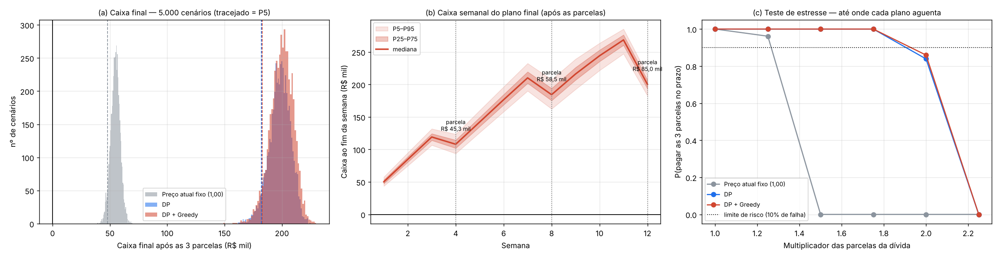
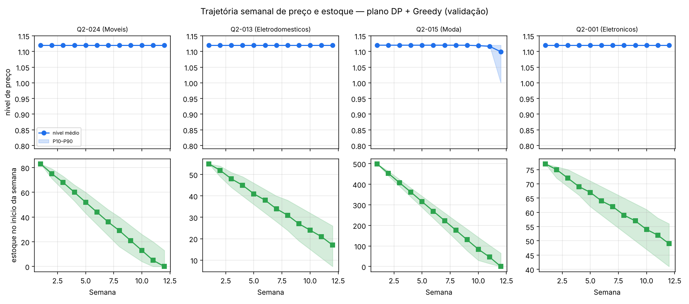
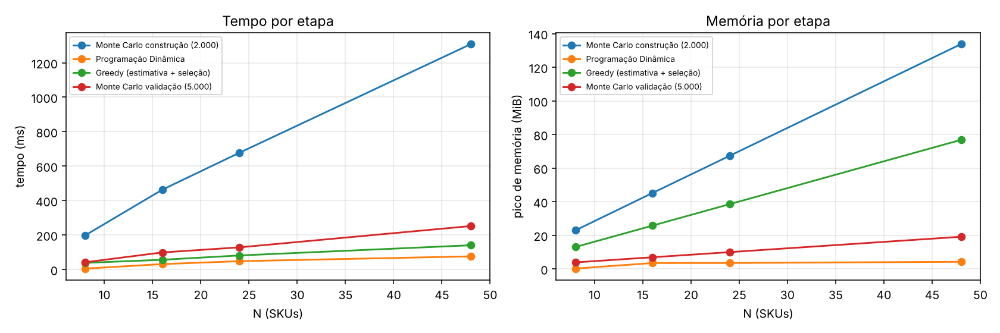

# Questão 2 — Plano de Sobrevivência em 12 Semanas

Grupo **G01** · instância `386e6252eb25` · seed **1025** · 24 SKUs · 2.000 cenários de construção · 5.000 de validação

*Gerado automaticamente em 26/10/2026 22:38. Não editar à mão: rode o main.py de novo.*

**Nesta questão utilizamos 3 algoritmos.** O *Monte Carlo* (2.000 cenários) estima a distribuição da demanda e o custo logístico para cada SKU, semana e preço; essas estatísticas alimentam a *Programação Dinâmica* (estado = semana e estoque restante), que escolhe a trajetória semanal de preços; o plano da DP orienta o *Greedy*, que distribui os destaques semanais; por fim o plano completo volta ao *Monte Carlo* em cenários novos para medir o risco.

Caixa inicial R$ 15.914,05 · parcelas — semana 4: R$ 45.313,13 · semana 8: R$ 58.529,46 · semana 12: R$ 84.962,13 (total R$ 188.804,72) · orçamento promocional semanal R$ 4.538,92 · limite de risco de falha 10%.

## 1. Monte Carlo de construção — demanda e caixa por nível de preço

Fontes de incerteza: demanda (lognormal com choque comum de mercado + Poisson), passeio aleatório do preço do concorrente e custo logístico. Tabela: **caixa semanal esperado** (R$, sem limite de estoque) de cada SKU em cada nível de preço — é o que a DP compara. Demanda média, P5 e P95 de cada combinação estão em `resumo_q2.json`.

| sku    |   demanda média (1,00) |   P5 |   P95 |   nível 0,82 |   nível 0,88 |   nível 0,94 |   nível 1,00 |   nível 1,06 |   nível 1,12 |
|:-------|-----------------------:|-----:|------:|-------------:|-------------:|-------------:|-------------:|-------------:|-------------:|
| Q2-001 |                   3,03 |    0 |     6 |      -581,89 |      -227,89 |        62,26 |       305,28 |       507,51 |       675,23 |
| Q2-002 |                   7,06 |    3 |    12 |      -152,50 |       557,10 |     1.143,12 |     1.634,48 |     2.051,74 |     2.411,45 |
| Q2-003 |                   4,01 |    1 |     8 |    -1.541,35 |    -1.025,28 |      -602,95 |      -248,39 |        47,27 |       298,18 |
| Q2-004 |                   3,06 |    0 |     6 |      -857,57 |      -452,82 |      -104,25 |       192,14 |       449,01 |       668,20 |
| Q2-005 |                   2,99 |    0 |     6 |      -179,40 |       -20,41 |       122,52 |       246,93 |       364,79 |       472,22 |
| Q2-006 |                  11,11 |    5 |    18 |       532,50 |       832,67 |     1.080,36 |     1.286,86 |     1.452,35 |     1.595,11 |
| Q2-007 |                   3,00 |    0 |     6 |       360,48 |       619,84 |       823,12 |       975,40 |     1.113,68 |     1.206,66 |
| Q2-008 |                   5,04 |    2 |     9 |      -873,64 |      -662,89 |      -484,09 |      -328,58 |      -190,25 |       -65,35 |
| Q2-009 |                   8,06 |    3 |    14 |        47,75 |        58,94 |        66,61 |        72,23 |        76,14 |        79,27 |
| Q2-010 |                  24,23 |   15 |    36 |       443,16 |       625,93 |       761,54 |       861,72 |       932,55 |       985,46 |
| Q2-011 |                  14,10 |    7 |    22 |     1.124,36 |     1.257,17 |     1.361,47 |     1.447,70 |     1.512,38 |     1.559,01 |
| Q2-012 |                   5,03 |    2 |     9 |    -1.135,97 |      -787,73 |      -508,24 |      -279,72 |       -94,81 |        59,10 |
| Q2-013 |                   4,05 |    1 |     8 |    -1.022,11 |      -343,49 |       233,55 |       720,42 |     1.145,45 |     1.494,63 |
| Q2-014 |                   6,06 |    2 |    11 |    -2.321,65 |    -1.468,84 |      -720,81 |       -63,30 |       529,85 |     1.055,70 |
| Q2-015 |                  60,53 |   41 |    83 |     9.988,11 |    10.327,26 |    10.438,33 |    10.385,47 |    10.261,45 |    10.061,17 |
| Q2-016 |                  13,07 |    7 |    20 |      -141,85 |        33,54 |       172,69 |       281,65 |       370,84 |       440,79 |
| Q2-017 |                   7,04 |    3 |    12 |       964,64 |     1.636,61 |     2.138,32 |     2.508,39 |     2.775,67 |     2.985,55 |
| Q2-018 |                  10,13 |    5 |    16 |       -78,13 |       224,80 |       478,10 |       691,78 |       867,44 |     1.026,41 |
| Q2-019 |                   6,05 |    2 |    11 |    -1.045,87 |      -632,15 |      -294,82 |       -16,42 |       213,46 |       407,38 |
| Q2-020 |                   4,03 |    1 |     8 |      -226,12 |      -144,57 |       -76,79 |       -18,59 |        31,16 |        74,17 |
| Q2-021 |                   3,00 |    0 |     6 |      -626,08 |      -306,53 |       -44,56 |       173,45 |       359,35 |       512,69 |
| Q2-022 |                   3,04 |    0 |     6 |    -1.103,26 |      -677,74 |      -337,99 |       -58,60 |       169,70 |       359,58 |
| Q2-023 |                   3,03 |    0 |     6 |    -1.127,59 |      -580,32 |      -155,79 |       172,66 |       427,77 |       634,67 |
| Q2-024 |                   9,09 |    4 |    15 |      -590,89 |     1.056,56 |     2.421,65 |     3.591,78 |     4.564,53 |     5.378,60 |

## 2. Programação Dinâmica

**Estado** (semana t, estoque restante s) · **decisão** nível de preço ou pausar · **transição** s' = s − min(s, D), com D sorteado da distribuição do Monte Carlo · **objetivo** V_t(s) = max_a Σ_d P(d)·[ω_t·min(s,d)·margem + V_{t+1}(s − min(s,d))], V_13 = 0 (depois da semana 12 o estoque não vira caixa). Bottom-Up: V_{t+1} é calculado uma vez por semana e reutilizado por todos os estados, decisões e demandas da semana t.

### Escolha do peso de urgência ρ (avaliada no Monte Carlo de construção)

|   rho |   P_3_parcelas |   P_sem4 |   P_sem8 |   P_sem12 |   caixa_final_esperado |   caixa_final_P5 | escolhido   |
|------:|---------------:|---------:|---------:|----------:|-----------------------:|-----------------:|:------------|
|  0,00 |         1,0000 |   1,0000 |   1,0000 |    1,0000 |             197.882,14 |       181.503,51 | sim         |
|  0,25 |         1,0000 |   1,0000 |   1,0000 |    1,0000 |             197.913,02 |       181.555,95 | não         |
|  0,50 |         1,0000 |   1,0000 |   1,0000 |    1,0000 |             197.966,35 |       181.368,45 | não         |
|  1,00 |         1,0000 |   1,0000 |   1,0000 |    1,0000 |             197.984,58 |       181.416,46 | não         |
|  2,00 |         1,0000 |   1,0000 |   1,0000 |    1,0000 |             198.036,50 |       181.593,71 | não         |

ρ escolhido = **0,00** → pesos semanais ['1,00', '1,00', '1,00', '1,00', '1,00', '1,00', '1,00', '1,00', '1,00', '1,00', '1,00', '1,00'].

### Caminho ótimo reconstruído — nível de preço por semana (vendas esperadas)

| sku    | S1      | S2      | S3      | S4      | S5      | S6      | S7      | S8      | S9      | S10      | S11      | S12      | estoque S1→S12   |
|:-------|:--------|:--------|:--------|:--------|:--------|:--------|:--------|:--------|:--------|:---------|:---------|:---------|:-----------------|
| Q2-001 | 1,12    | 1,12    | 1,12    | 1,12    | 1,12    | 1,12    | 1,12    | 1,12    | 1,12    | 1,12     | 1,12     | 1,12     | 77 → 45          |
| Q2-002 | 1,12    | 1,12    | 1,12    | 1,12    | 1,12    | 1,12    | 1,12    | 1,12    | 1,12    | esgotado | esgotado | esgotado | 52 → 0           |
| Q2-003 | 1,12    | 1,12    | 1,12    | 1,12    | 1,12    | 1,12    | 1,12    | 1,12    | 1,12    | 1,12     | 1,12     | 1,12     | 77 → 44          |
| Q2-004 | 1,12    | 1,12    | 1,12    | 1,12    | 1,12    | 1,12    | 1,12    | 1,12    | 1,12    | 1,12     | 1,12     | 1,12     | 39 → 6           |
| Q2-005 | 1,12    | 1,12    | 1,12    | 1,12    | 1,12    | 1,12    | 1,12    | 1,12    | 1,12    | 1,12     | esgotado | esgotado | 27 → 0           |
| Q2-006 | 1,12    | 1,12    | 1,12    | 1,12    | 1,12    | 1,12    | 1,12    | 1,12    | 1,12    | 1,12     | esgotado | esgotado | 89 → 0           |
| Q2-007 | 1,12    | 1,12    | 1,12    | 1,12    | 1,12    | 1,12    | 1,12    | 1,12    | 1,12    | 1,12     | 1,12     | 1,12     | 32 → 7           |
| Q2-008 | pausado | pausado | pausado | pausado | pausado | pausado | pausado | pausado | pausado | pausado  | pausado  | pausado  | 46 → 46          |
| Q2-009 | 1,12    | 1,12    | 1,12    | 1,12    | 1,12    | 1,12    | 1,12    | 1,12    | 1,12    | 1,12     | 1,12     | 1,12     | 84 → 16          |
| Q2-010 | 1,12    | 1,12    | 1,12    | 1,12    | 1,12    | 1,12    | 1,12    | 1,12    | 1,12    | 1,12     | 1,12     | 1,12     | 399 → 190        |
| Q2-011 | 1,12    | 1,12    | 1,12    | 1,12    | 1,12    | 1,12    | 1,12    | 1,12    | 1,12    | 1,12     | 1,12     | 1,12     | 271 → 139        |
| Q2-012 | 1,12    | 1,12    | 1,12    | 1,12    | 1,12    | 1,12    | 1,12    | 1,12    | 1,12    | 1,12     | 1,12     | esgotado | 41 → 0           |
| Q2-013 | 1,12    | 1,12    | 1,12    | 1,12    | 1,12    | 1,12    | 1,12    | 1,12    | 1,12    | 1,12     | 1,12     | 1,12     | 55 → 16          |
| Q2-014 | 1,12    | 1,12    | 1,12    | 1,12    | 1,12    | 1,12    | 1,12    | 1,12    | 1,12    | 1,12     | esgotado | esgotado | 51 → 0           |
| Q2-015 | 1,12    | 1,12    | 1,12    | 1,12    | 1,12    | 1,12    | 1,12    | 1,12    | 1,12    | 1,12     | 1,12     | 1,12     | 499 → 1          |
| Q2-016 | 1,12    | 1,12    | 1,12    | 1,12    | 1,12    | 1,12    | 1,12    | 1,12    | 1,12    | 1,12     | 1,12     | 1,12     | 312 → 191        |
| Q2-017 | 1,12    | 1,12    | 1,12    | 1,12    | 1,12    | 1,12    | 1,12    | 1,12    | 1,12    | 1,12     | 1,12     | 1,12     | 75 → 10          |
| Q2-018 | 1,12    | 1,12    | 1,12    | 1,12    | 1,12    | 1,12    | 1,12    | 1,12    | 1,12    | 1,12     | 1,12     | 1,12     | 265 → 166        |
| Q2-019 | 1,12    | 1,12    | 1,12    | 1,12    | 1,12    | pausado | 1,12    | 1,12    | 1,12    | 1,12     | esgotado | esgotado | 40 → 0           |
| Q2-020 | 1,12    | 1,12    | 1,12    | 1,12    | 1,12    | 1,12    | 1,12    | 1,12    | 1,12    | 1,12     | 1,12     | 1,12     | 50 → 10          |
| Q2-021 | 1,12    | 1,12    | 1,12    | 1,12    | 1,12    | 1,12    | 1,12    | 1,12    | 1,12    | 1,12     | 1,12     | 1,12     | 59 → 26          |
| Q2-022 | 1,12    | 1,12    | 1,12    | 1,12    | 1,12    | 1,12    | 1,12    | 1,12    | 1,12    | 1,12     | 1,12     | 1,12     | 66 → 37          |
| Q2-023 | 1,12    | 1,12    | 1,12    | 1,12    | 1,12    | 1,12    | 1,12    | 1,12    | 1,12    | 1,12     | 1,12     | 1,12     | 53 → 31          |
| Q2-024 | 1,12    | 1,12    | 1,12    | 1,12    | 1,12    | 1,12    | 1,12    | 1,12    | 1,12    | 1,12     | 1,12     | esgotado | 83 → 0           |

## 3. Greedy semanal de destaques

Até 4 destaques por semana (+30% de demanda), dentro do orçamento semanal; só entram candidatos com benefício/custo ≥ 1,20. Resultado: **12 destaques**, gasto de R$ 4.168,98 de R$ 54.467,04 disponíveis nas 12 semanas.

Melhores candidatos por SKU (melhor semana de cada um):

|   semana | sku    |   delta_unid |   margem_unit |   p_sobra |   beneficio |   custo |   razao |
|---------:|:-------|-------------:|--------------:|----------:|------------:|--------:|--------:|
|        8 | Q2-011 |         3,57 |        132,00 |      1,00 |      471,70 |  348,72 |   1,353 |
|        8 | Q2-017 |         1,69 |        532,11 |      0,75 |      675,08 |  670,20 |   1,007 |
|       11 | Q2-010 |         5,83 |         51,05 |      1,00 |      297,56 |  307,65 |   0,967 |
|       12 | Q2-018 |         2,64 |        117,75 |      1,00 |      310,52 |  392,64 |   0,791 |
|        8 | Q2-013 |         1,06 |        427,48 |      0,93 |      419,93 |  606,04 |   0,693 |
|        5 | Q2-007 |         0,75 |        485,79 |      0,61 |      221,01 |  358,28 |   0,617 |

Destaques escolhidos:

|   semana | sku    |   razao |   beneficio_esperado |   custo |   saldo_orcamento |
|---------:|:-------|--------:|---------------------:|--------:|------------------:|
|        1 | Q2-011 |   1,344 |               465,05 |  345,95 |          4.192,97 |
|        2 | Q2-011 |   1,344 |               465,11 |  345,97 |          4.192,95 |
|        3 | Q2-011 |   1,346 |               466,35 |  346,47 |          4.192,45 |
|        4 | Q2-011 |   1,345 |               465,59 |  346,14 |          4.192,78 |
|        5 | Q2-011 |   1,347 |               466,95 |  346,74 |          4.192,18 |
|        6 | Q2-011 |   1,350 |               469,16 |  347,64 |          4.191,28 |
|        7 | Q2-011 |   1,351 |               470,65 |  348,31 |          4.190,61 |
|        8 | Q2-011 |   1,353 |               471,70 |  348,72 |          4.190,20 |
|        9 | Q2-011 |   1,350 |               469,28 |  347,70 |          4.191,22 |
|       10 | Q2-011 |   1,350 |               470,01 |  348,03 |          4.190,89 |
|       11 | Q2-011 |   1,352 |               471,54 |  348,66 |          4.190,26 |
|       12 | Q2-011 |   1,352 |               471,53 |  348,65 |          4.190,27 |

## 4. Validação Monte Carlo — risco do plano completo

5.000 cenários novos (seed 778802), não usados para construir a política. Comparação com a política atual (preço 1,00 fixo) e com a DP sem o Greedy. Percentil de risco escolhido pelo grupo: **P5** do caixa final.

| indicador                 |   Preço atual fixo (1,00) |           DP |   DP + Greedy |
|:--------------------------|--------------------------:|-------------:|--------------:|
| P(pagar semana 4)         |                    1,0000 |       1,0000 |        1,0000 |
| P(pagar semana 8)         |                    1,0000 |       1,0000 |        1,0000 |
| P(pagar semana 12)        |                    1,0000 |       1,0000 |        1,0000 |
| P(pagar as 3 no prazo)    |                    1,0000 |       1,0000 |        1,0000 |
| P(falha)                  |                    0,0000 |       0,0000 |        0,0000 |
| atende_limite_risco       |                       sim |          sim |           sim |
| caixa_final_esperado      |                 54.790,53 |   198.150,31 |    199.683,00 |
| caixa_final_P5            |                 47.892,77 |   181.923,16 |    182.649,66 |
| caixa_final_P50           |                 54.898,52 |   198.681,61 |    200.177,07 |
| caixa_final_P95           |                 61.389,84 |   212.762,63 |    214.822,04 |
| receita_esperada          |              1.632.204,69 | 1.660.053,28 |  1.675.240,04 |
| margem_contribuicao_pct   |                     13,95 |        22,35 |         22,24 |
| gasto_promocional         |                      0,00 |         0,00 |      4.168,98 |
| estoque_final_unid_medio  |                    669,77 |       916,86 |        874,17 |
| estoque_final_valor_custo |                281.302,53 |   386.458,75 |    380.110,22 |
| cenarios                  |                     5.000 |        5.000 |         5.000 |

### Cenários de falha

Nenhum dos cenários de validação falhou com a dívida oficial. Os 5 piores cenários (menor caixa final) mostram o que derruba o caixa:

|   cenario |   caixa_final | pagou_sem4   | pagou_sem8   | pagou_sem12   |   choque_mercado_medio |   fator_concorrente_sem12 |   fator_logistica_medio |
|----------:|--------------:|:-------------|:-------------|:--------------|-----------------------:|--------------------------:|------------------------:|
|     3.216 |    148.846,15 | sim          | sim          | sim           |                 -0,538 |                     1,036 |                   1,000 |
|     4.765 |    157.053,30 | sim          | sim          | sim           |                 -0,709 |                     1,033 |                   1,003 |
|       216 |    159.380,86 | sim          | sim          | sim           |                 -0,432 |                     1,051 |                   0,991 |
|     4.980 |    160.637,97 | sim          | sim          | sim           |                 -0,318 |                     0,927 |                   1,000 |
|     4.217 |    162.417,22 | sim          | sim          | sim           |                  0,220 |                     0,984 |                   1,001 |

### Teste de estresse — parcelas multiplicadas

|   multiplicador_dividas |   rho_escolhido |   P(3 parcelas) — Preço atual fixo (1,00) |   P(3 parcelas) — DP |   P(3 parcelas) — DP + Greedy |
|------------------------:|----------------:|------------------------------------------:|---------------------:|------------------------------:|
|                    1,00 |            0,00 |                                    1,0000 |               1,0000 |                        1,0000 |
|                    1,25 |            0,25 |                                    0,9614 |               1,0000 |                        1,0000 |
|                    1,50 |            0,50 |                                    0,0000 |               1,0000 |                        1,0000 |
|                    1,75 |            1,00 |                                    0,0000 |               1,0000 |                        1,0000 |
|                    2,00 |            2,00 |                                    0,0000 |               0,8390 |                        0,8596 |
|                    2,25 |            2,00 |                                    0,0000 |               0,0000 |                        0,0000 |

*(a) distribuição do caixa final, (b) caixa semanal do plano final, (c) teste de estresse*

*Trajetória semanal de preço e estoque de SKUs representativos (média e faixa P10–P90 na validação)*

## 5. Desempenho: tempo e memória

Nesta execução (instância oficial):

| etapa                                  |   tempo_ms |   memoria_pico_KiB |
|:---------------------------------------|-----------:|-------------------:|
| MC construção (sorteio + estatísticas) |      747,1 |           55.211,5 |
| DP (um ρ)                              |       35,9 |            3.592,2 |
| Greedy (seleção semanal)               |       12,3 |              138,9 |
| MC validação (simulação do plano)      |      332,2 |           79.286,0 |

Escalabilidade em quatro tamanhos de entrada (N = 48 é o catálogo replicado):

| etapa                          |   N |   estoque_total |   memoria_KiB |   estados |   tempo_ms |
|:-------------------------------|----:|----------------:|--------------:|----------:|-----------:|
| Monte Carlo construção (2.000) |   8 |             439 |        23.447 |         — |      197,8 |
| Programação Dinâmica           |   8 |             439 |           173 |     5.364 |        5,0 |
| Greedy (estimativa + seleção)  |   8 |             439 |        13.310 |         — |       38,2 |
| Monte Carlo validação (5.000)  |   8 |             439 |         3.948 |         — |       41,7 |
| Monte Carlo construção (2.000) |  16 |           2.151 |        46.255 |         — |      463,0 |
| Programação Dinâmica           |  16 |           2.151 |         3.561 |    26.004 |       31,1 |
| Greedy (estimativa + seleção)  |  16 |           2.151 |        26.375 |         — |       56,2 |
| Monte Carlo validação (5.000)  |  16 |           2.151 |         7.074 |         — |       98,8 |
| Monte Carlo construção (2.000) |  24 |           2.842 |        68.905 |         — |      677,4 |
| Programação Dinâmica           |  24 |           2.842 |         3.592 |    34.392 |       48,1 |
| Greedy (estimativa + seleção)  |  24 |           2.842 |        39.440 |         — |       81,3 |
| Monte Carlo validação (5.000)  |  24 |           2.842 |        10.200 |         — |      128,3 |
| Monte Carlo construção (2.000) |  48 |           5.684 |       137.005 |         — |    1.308,2 |
| Programação Dinâmica           |  48 |           5.684 |         4.314 |    68.784 |       76,0 |
| Greedy (estimativa + seleção)  |  48 |           5.684 |        78.636 |         — |      140,5 |
| Monte Carlo validação (5.000)  |  48 |           5.684 |        19.578 |         — |      252,0 |

Monte Carlo de construção variando o número de cenários:

|   cenarios |   memoria_KiB |   tempo_ms |
|-----------:|--------------:|-----------:|
|      1.000 |        34.765 |      242,3 |
|      2.000 |        68.899 |      530,9 |
|      5.000 |       170.823 |    1.866,0 |
|     10.000 |       341.002 |    3.422,2 |

Reutilização de subproblemas — DP Top-Down com memoization × Bottom-Up:

| sku    |   estoque |   valor_bottom_up |   valor_top_down | iguais   |   subproblemas_distintos |   reutilizacoes_cache |   tempo_bottom_up_s |   tempo_top_down_s |
|:-------|----------:|------------------:|-----------------:|:---------|-------------------------:|----------------------:|--------------------:|-------------------:|
| Q2-005 |        27 |          4.552,52 |         4.552,52 | sim      |                      322 |                21.154 |              0,0006 |             0,0164 |
| Q2-007 |        32 |         13.824,23 |        13.824,23 | sim      |                      373 |                25.477 |              0,0009 |             0,0284 |
| Q2-004 |        39 |          7.930,33 |         7.930,33 | sim      |                      439 |                29.630 |              0,0010 |             0,0233 |

*Tempo e memória por etapa em função do número de SKUs*
